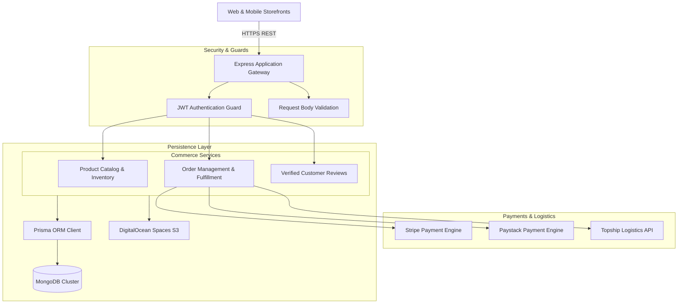

# Bolu Bocool Backend - Multi-Gateway E-Commerce API

<p align="center">
  
</p>

<p align="center">
  <a href="https://nodejs.org"></a>
  <a href="https://expressjs.com"></a>
  <a href="https://www.typescriptlang.org"></a>
  <a href="https://www.prisma.io"></a>
  <a href="https://www.mongodb.com"></a>
  <a href="https://paystack.com"></a>
  <a href="https://stripe.com"></a>
  <a href="LICENSE"></a>
</p>

---

## 📖 Overview

**bolubocool_backend** is an enterprise e-commerce backend API engineered with Node.js, Express.js, TypeScript, and Prisma ORM with MongoDB. It features multi-gateway payment integrations (Stripe and Paystack), Topship automated cross-border African shipping logistics, product inventory lifecycle management, customer reviews, and DigitalOcean Spaces media hosting.

---

## ⚡ Key Features

- 💳 **Dual Payment Gateways:** Seamless checkout supporting Stripe for global cards and Paystack for Nigerian & African accounts.
- 🚚 **Topship Logistics Integration:** Automated rate fetching, shipping label generation, and tracking across African corridors.
- 📦 **Product Catalog & Inventory:** SKU tracking, multi-variant products, categories, tags, and stock controls.
- ⭐ **Verified Review System:** Customer ratings, verified purchase tags, and automated moderation.
- ✉️ **Multi-Vendor Email Dispatch:** Transaction confirmations and order dispatch emails via Brevo and Mailgun relays.
- ☁️ **DigitalOcean Spaces CDN:** AWS S3-compatible cloud storage for product photography.

---

## 🏗️ System Architecture



---

## 📂 Directory Structure

```text
.
├── src/
│   ├── app/
│   ├── components/
│   └── ...
├── assets/
│   └── banner.svg
├── .env.example
├── .gitignore
├── package.json
├── README.md
└── LICENSE
```

---

## 🛠️ Tech Stack & Dependencies

| Layer / Library | Version | Description |
|---|---|---|
| **Express.js** | `v4.21` | HTTP routing and middleware framework |
| **TypeScript** | `v5.x` | Type-safe backend architecture |
| **Prisma ORM** | `v6.x` | MongoDB database abstraction and schema management |
| **Stripe SDK** | `v17.x` | International credit/debit card processing |
| **Paystack API** | `REST` | African payment gateway processing |
| **Topship API** | `REST` | Cross-border African shipping & logistics |
| **AWS SDK (S3 Client)** | `v3.x` | DigitalOcean Spaces file storage integration |

---

## ⚙️ Environment Variables

Create a `.env` file in the project root based on the provided sample:

```bash
cp .env.example .env
```

Configurable variables:

```env
PORT=3797
NODE_ENV=development
DATABASE_URL=mongodb+srv://<username>:<password>@cluster.mongodb.net/bolubocool?retryWrites=true&w=majority

JWT_ACCESS_SECRET=your_jwt_access_secret
JWT_REFRESH_SECRET=your_jwt_refresh_secret

# Stripe
STRIPE_SECRET_KEY=sk_test_your_stripe_key
STRIPE_WEBHOOK_SECRET=whsec_your_webhook_secret

# Paystack
PAYSTACK_SECRET_KEY=sk_test_your_paystack_key

# Topship Logistics
TOPSHIP_BASE_URL=https://topship-staging.africa/api
TOPSHIP_API_KEY=your_topship_api_key

# DigitalOcean Spaces
DO_SPACE_ENDPOINT=https://nyc3.digitaloceanspaces.com
DO_SPACE_ACCESS_KEY=your_access_key
DO_SPACE_SECRET_KEY=your_secret_key
DO_SPACE_BUCKET=bolubocool-storage
```

---

## 🚀 Getting Started

### Prerequisites

- Node.js (v20.x or higher recommended)
- Package Manager (`npm`, `yarn`, or `pnpm`)

### Installation

```bash
# Clone repository
git clone https://github.com/shahjalal-labs/bolubocool_backend.git
cd bolubocool_backend

# Install dependencies
npm install
```

### Running Locally

```bash
# Start development server
npm run dev
# or for backend services
npm run start:dev
```

### Building for Production

```bash
# Create production build
npm run build

# Start production server
npm start
```

---

## 📄 License

This project is licensed under the [ISC License](LICENSE).
